<div align="center">


# 🍱 BentoMeter

### べんとうメーター　〜 your tiny calorie buddy 〜

**Snap your meal → get the calories → know what to eat next.** ✨
<br/>A minimal, kawaii daily calorie tracker for Android & iOS, powered by Gemini.
<br/>Rate-limited? Hand it to your Gemini/ChatGPT app 💬, or run it fully offline on your phone 📱.

`(っ˘ڡ˘ς)　いただきます！`


</div>

---

## 🌸 What is this? ｜ これはなに？

BentoMeter is a pocket-sized calorie tracker that doesn't make you type every grain of rice. 🍚

Take a photo of your plate and one Gemini request handles everything:

1. 🔍 **Figure out what's on it.** Each food is listed separately with its portion, calories, and macros.
2. 🍙 **Suggest your next meal.** It looks at what you've already eaten today and suggests what to eat next, when, and roughly how many calories.

Everything else stays **on your phone**: meals, photos, profile, and API key. No accounts, no servers, no tracking. `(｡•̀ᴗ-)✧`

And when the free Gemini API says *"429: quota exceeded"*, you're still not stuck:

- 💬 **[Ask a chat app](#⑥-ask-a-chat-app-the-rate-limit-escape-hatch--チャットにおまかせ):** BentoMeter writes the perfect prompt, you send it to the Gemini or ChatGPT app you already have, and the answer is imported straight back. It's free, unlimited, and just as smart.
- 📱 **[On-device AI](#⑦-on-device-ai-no-internet-needed--ローカル):** a tiny vision model runs right on your phone, and calories come from a built-in Indian food table.

---

## 🎀 UI workflow ｜ つかいかた

> All screenshots are in ☀️ **Washi** (light) mode. There's also a cozy 🌙 **Yoru** (dark) mode!
> The Today, meal, history and mess screenshots are from a real day of eating at IIIT-H's Kadamba mess 🍛

### ① First launch: say hi to your onigiri ｜ はじめまして

The app works out your daily calorie target from your body stats with the Mifflin-St Jeor formula. You can also set your own number. Then paste a Gemini API key and you're done!

<table>
  <tr>
    <td align="center"><br/><sub><b>Welcome</b> ようこそ</sub></td>
    <td align="center"><br/><sub><b>About you</b> あなたについて</sub></td>
    <td align="center"><br/><sub><b>Goal &amp; target</b> もくひょう</sub></td>
    <td align="center"><br/><sub><b>Connect Gemini</b> AIとつなぐ</sub></td>
  </tr>
</table>

### ② Log a meal: snap, analyze, review ｜ ごはんをきろく

The meal slot is picked from the clock (🍳 breakfast, 🍱 lunch, 🍡 snack, 🍜 dinner, 🌙 late snack). Snap a photo or pick one from your gallery. You can add a note for Gemini like *"ate half the rice"*, then tap **Analyze**. Your onigiri thinks hard while it waits `(・・ )?`

<table>
  <tr>
    <td align="center"><br/><sub><b>Log a meal</b> さつえい</sub></td>
    <td align="center"><br/><sub><b>Photo picked</b> アルバム</sub></td>
    <td align="center"><br/><sub><b>Analyzing…</b> しょうしょうお待ちください</sub></td>
  </tr>
</table>

### ③ Review &amp; save: everything is editable ｜ かくにん

Gemini returns every item with portion, kcal, and macros. Tap **+ / −** to change quantities and the numbers rescale instantly on-device. Mixed dishes come split into parts, so you can fix each one: chicken biryani becomes **biryani rice + chicken pieces**, and a paneer or chicken curry becomes **the pieces (counted) + the gravy**. You can also rename items, change units, fix kcal, and add or remove items. Below that is your **Next up** suggestion, with 2–3 ideas and a tiny pep talk. ٩(◕‿◕｡)۶

<table>
  <tr>
    <td align="center"><br/><sub><b>Split &amp; editable items</b> なかみ</sub></td>
    <td align="center"><br/><sub><b>Next up</b> つぎは</sub></td>
  </tr>
</table>

### ④ Your day, as a bento box ｜ きょうのごはん

The calorie ring shows how much is left today (のこり), with soft macro bars for protein, carbs, and fat. Each meal fills its own bento compartment with its photo. Tap a meal to see the full breakdown, edit it, or delete it.

<table>
  <tr>
    <td align="center"><br/><sub><b>Empty day</b> まだなにも…</sub></td>
    <td align="center"><br/><sub><b>A real mess day</b> いただきました</sub></td>
    <td align="center"><br/><sub><b>Biryani, split up</b> ごはんのなかみ</sub></td>
  </tr>
</table>

### ⑤ History &amp; settings ｜ きろく・せってい

Look back at the last 7 days and the month calendar, where each day gets a dot: 🟡 under, 🟢 on target, 🔴 over. In Settings you can switch themes, change your profile, pick a Gemini model, and back up your data.

<table>
  <tr>
    <td align="center"><br/><sub><b>History</b> きろく</sub></td>
    <td align="center"><br/><sub><b>Settings</b> せってい</sub></td>
  </tr>
</table>

### ⑥ Ask a chat app: the rate-limit escape hatch ｜ チャットにおまかせ

The free Gemini API runs out fast. Your **Gemini app** (or ChatGPT) doesn't, and it's just as smart. So BentoMeter turns it into a calorie engine with **one tap out and one tap back** 🪄

1. **Tap "Ask a chat app instead"**, or pick it from the error card when the API fails.
2. **Tap "Copy prompt & share photo".** BentoMeter copies a ready-made prompt that has your whole day in it: what you've eaten, your targets, the time, and the exact JSON format it needs. Then it opens the share sheet with your photo.
3. **Pick Gemini, paste, send.** The prompt already explains everything, so you don't type a word.
4. **Tap "Copy code" on the reply and come back.** BentoMeter spots the answer on your clipboard and **fills it in by itself** ✨
5. **Tap "Import meal".** You land on the normal review screen with every item, portion, kcal, macro, and the **Next up** suggestion. Edit anything, then save.

The import doesn't mind messy replies: code fences, chatty text around the JSON, smart quotes, and trailing commas all parse fine. No API key, no quota, no waiting for tomorrow `٩(ˊᗜˋ*)و`

<table>
  <tr>
    <td align="center">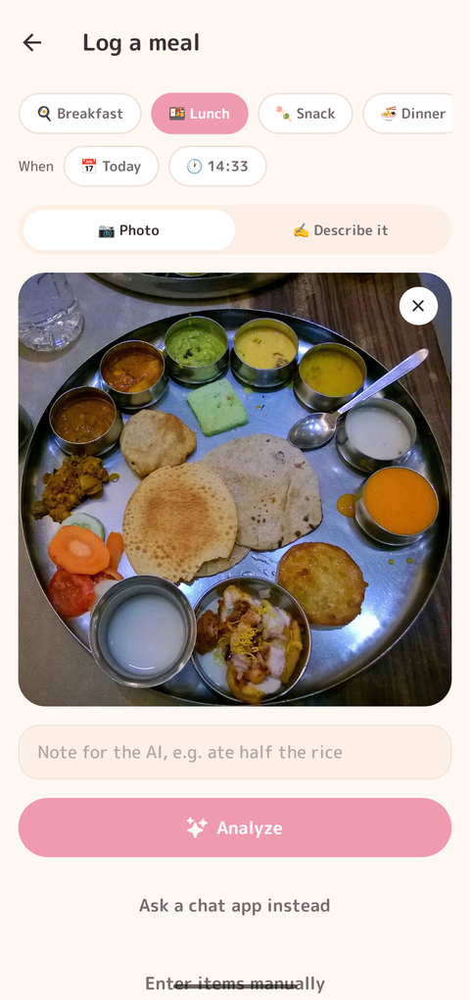<br/><sub><b>Ask a chat app</b> えらぶ</sub></td>
    <td align="center">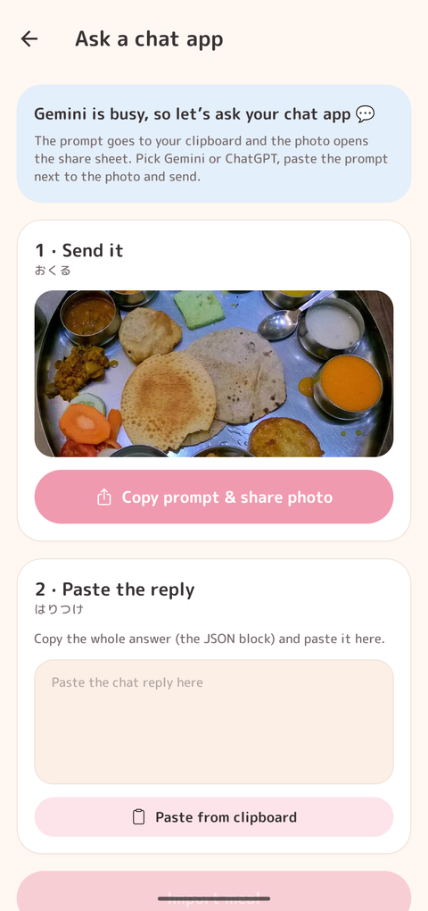<br/><sub><b>① Copy &amp; share</b> おくる</sub></td>
    <td align="center">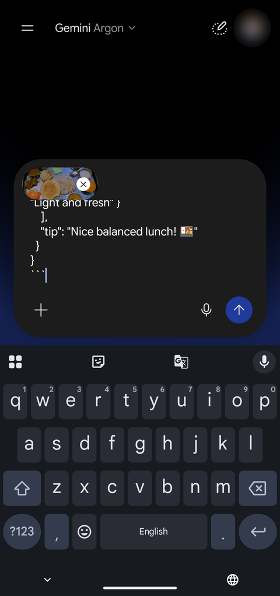<br/><sub><b>② Paste in Gemini</b> はりつけ</sub></td>
    <td align="center">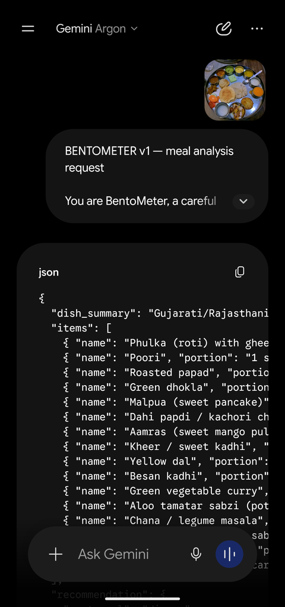<br/><sub><b>③ Gemini answers</b> こたえ</sub></td>
  </tr>
  <tr>
    <td align="center">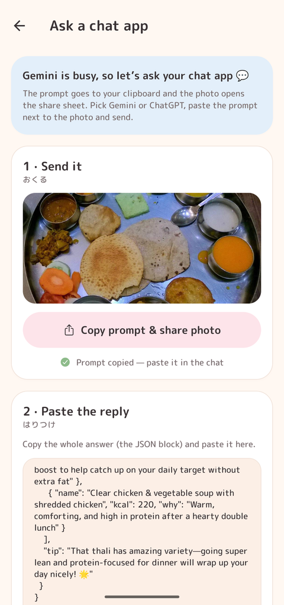<br/><sub><b>④ Auto-filled back</b> おかえり</sub></td>
    <td align="center">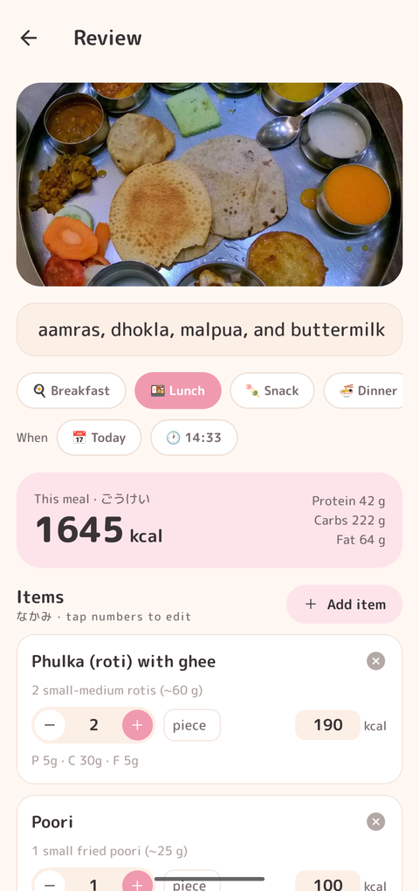<br/><sub><b>⑤ Imported &amp; editable</b> なかみ</sub></td>
    <td align="center">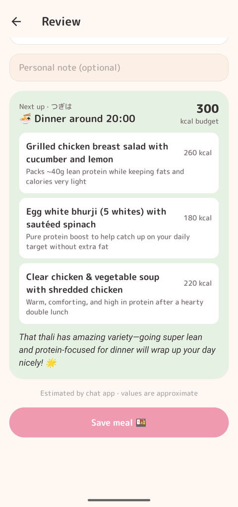<br/><sub><b>Next up included</b> つぎは</sub></td>
    <td></td>
  </tr>
</table>

### ⑦ On-device AI: no internet needed ｜ ローカル

Download the model once from **Settings → On-device AI**, and BentoMeter can log meals in airplane mode. Type *"I ate 2 rotis, around 2 small cups of paneer, and 2 masala omelettes"* (or snap a photo):

- **A small vision model on your phone names the foods.**
- **The built-in Indian food table supplies the calories:** roti 185, paneer 560, and masala omelettes 448 kcal.

On a Pixel 9a this took **~43 s from a cold start**, with no network at all. Turn on **Always use on-device** to skip Gemini entirely, or leave it off and it's offered whenever Gemini fails.

<table>
  <tr>
    <td align="center">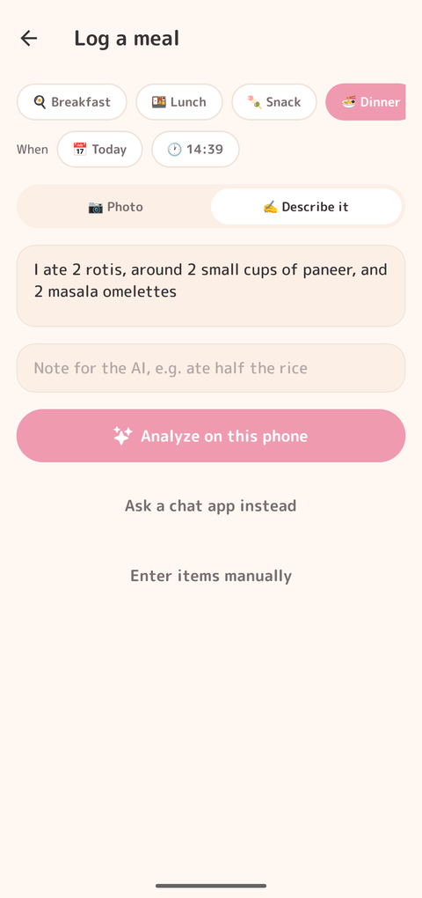<br/><sub><b>Describe it</b> ことばで</sub></td>
    <td align="center">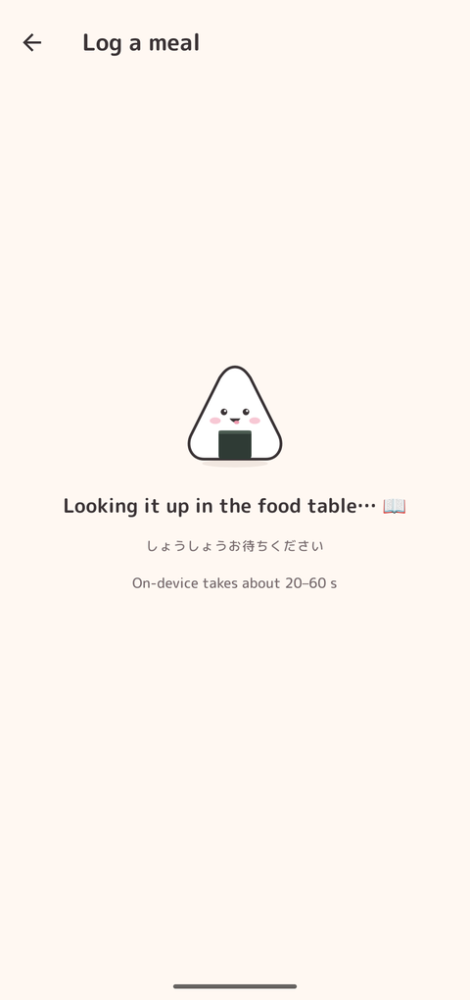<br/><sub><b>Thinking on your phone</b> かんがえちゅう</sub></td>
    <td align="center">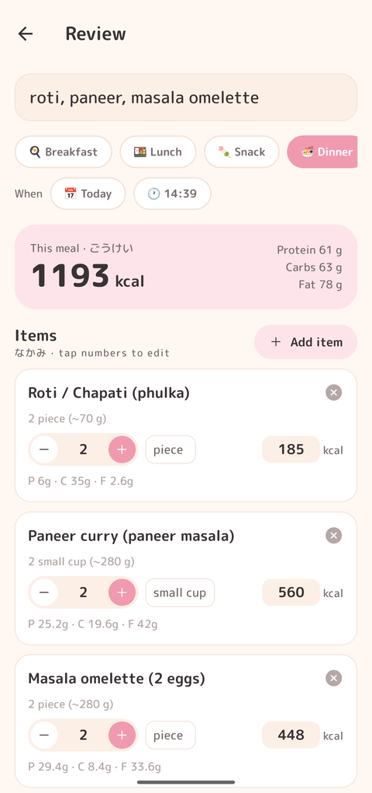<br/><sub><b>Matched to the food table</b> なかみ</sub></td>
    <td align="center">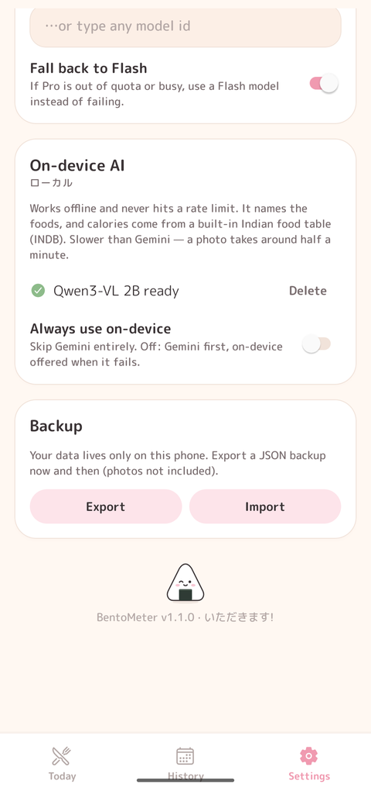<br/><sub><b>Settings · v1.1.0</b> せってい</sub></td>
  </tr>
</table>

### ⑧ IIIT-H mess mode: the menu as a hint ｜ しょくどう 🏫

At an IIIT Hyderabad mess, BentoMeter can fetch that meal's menu from [dining.iiit.ac.in](https://dining.iiit.ac.in/menu) and send it along with your photo. Dishes then get their real mess names, so look-alike curries and dals stop getting mixed up. `(๑˃ᴗ˂)ﻭ`

1. **Turn it on in Settings → IIIT-H mess 🏫.** It's off by default, so nobody else ever sees it.
2. **When you log breakfast, lunch or dinner,** a 🍛 **At the mess** card appears. Toggle it off for outside food. Snacks are logged without it.
3. **Pick the mess from the dropdown:** Kadamba, Yuktāhār, Bakul or Palāsh. Kadamba and Bakul use their non-veg menu, which is the veg menu plus the non-veg dishes. Tap **See lunch menu** to check what's cooking.
4. **(Optional) add your dining-portal key** in the same Settings card. The dropdown then starts on the mess you're registered at, shows when you checked in, and adds any extras you bought. Kadamba dinner also knows about its 2-egg omelette extra.

The menu reaches every engine: the Gemini API, the chat-app prompt and the on-device model (a shorter version for that one).

<table>
  <tr>
    <td align="center">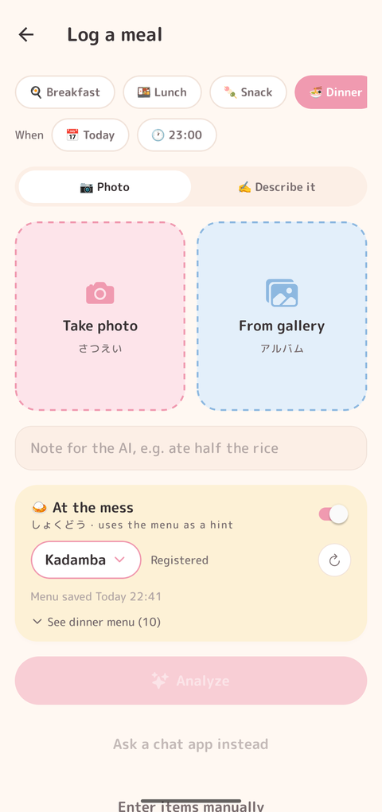<br/><sub><b>At the mess</b> しょくどう</sub></td>
    <td align="center">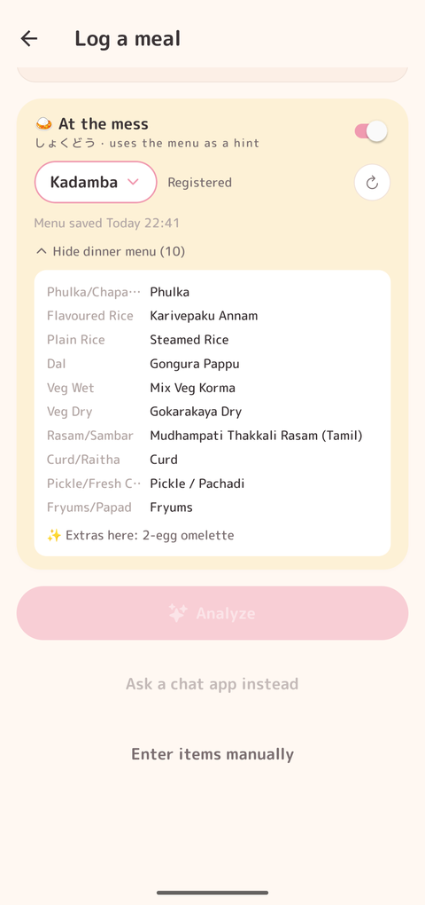<br/><sub><b>Tonight's menu</b> こんばんのメニュー</sub></td>
    <td align="center">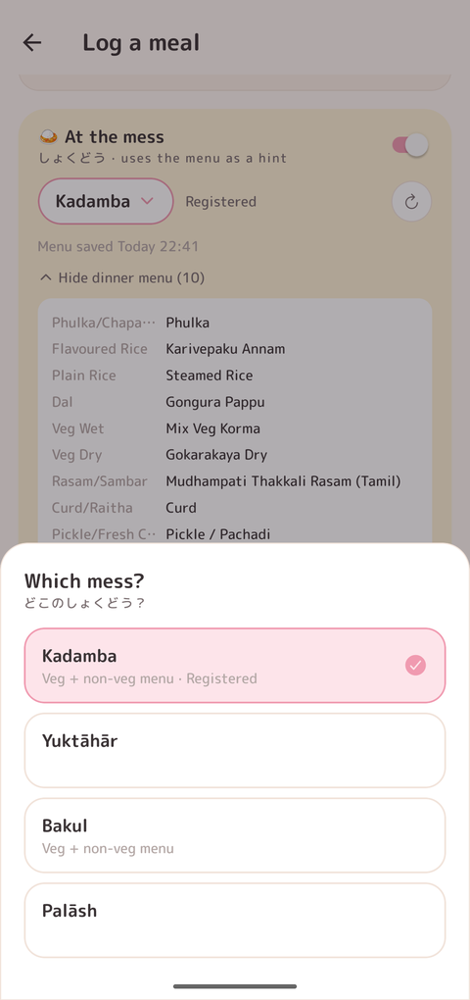<br/><sub><b>Which mess?</b> どこ？</sub></td>
    <td align="center">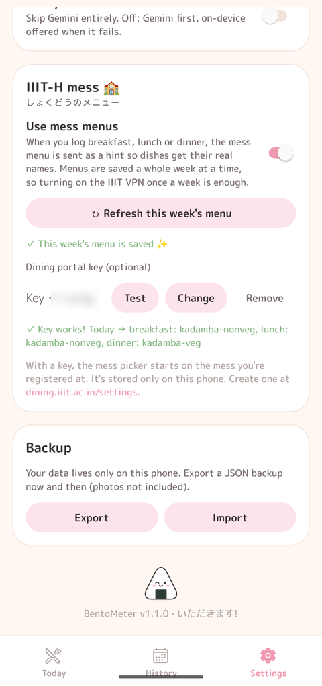<br/><sub><b>Settings</b> せってい</sub></td>
  </tr>
</table>

**🔌 Off campus?** The dining portal only works on the campus network or the **IIIT VPN**. One download saves the **whole week's menu**, so turning the VPN on once a week is enough. The card shows when the menu was saved. If a day is missing or the menu looks different, turn the VPN on and tap **↻** on the card (or **Refresh this week's menu** in Settings) to fetch the menu, your registration and extras again. If the menu can't load, analysis carries on without it.

| Same biryani photo | Without the menu | With Kadamba's lunch menu |
|---|---|---|
| Rice | Chicken Biryani | **Chicken Dum Biryani** |
| Curry | "Salan / Mirchi Gravy" | **Mirchi Ka Salan** |
| Curd | Raita | **Raitha** |

<sub>Menus come from the public `GET /api/mess/menus?on=YYYY-MM-DD` endpoint. Registrations come from `GET /api/registration?date=…`, which needs your key in the `Authorization` header. The key is kept in secure storage on your phone and never leaves it except to talk to the dining portal.</sub>

<sub>Thali photo in the chat-app walkthrough: <a href="https://commons.wikimedia.org/wiki/File:Traditional_North_Indian_Thali.jpg">"Traditional North Indian Thali"</a> by Shashank shk, <a href="https://creativecommons.org/licenses/by-sa/4.0">CC BY-SA 4.0</a>.</sub>

---

## ✨ What it can do ｜ できること

| | Feature | |
|---|---|---|
| 📸 | **Photo logging:** take a photo or pick from the gallery. Gemini identifies each food with portion, kcal, protein, carbs, and fat | しゃしん |
| ✍️ | **"Describe it" mode:** no photo? Just type *"a cup of masala chai and 4 Parle-G biscuits"* | ことばで |
| 📝 | **Manual entry:** add items yourself, no AI needed | てにゅうりょく |
| 💬 | **Notes for Gemini:** e.g. *"ate half the rice"* or *"no oil"*, for better estimates | メモ |
| ⏰ | **Smart meal slot:** picked from the time of day. Falls back to *snack* if that meal is already logged | じかん |
| 🎚️ | **Editable review:** quantity steppers rescale kcal and macros locally (values are stored per unit). Edit names, units, and kcal; add or remove items | へんしゅう |
| 🍙 | **"Next up" suggestion:** next meal, time, kcal budget, 2–3 ideas, and a friendly tip, all from the same request. A refresh button appears if you change the meal by more than 15% | つぎは |
| 🗓️ | **Log any day:** add earlier meals, log other days, and edit or delete past meals | いつでも |
| 🍱 | **Bento-box day view:** calorie ring, macro bars, and photo compartments | おべんとう |
| 📊 | **History:** 7-day chart and a month calendar with under / on target / over dots. Tap a day to jump to it | きろく |
| 🧮 | **Personal targets:** BMR/TDEE with Mifflin-St Jeor plus your activity level and goal (lose / maintain / gain), or set your own number | もくひょう |
| 🤖 | **Gemini model picker + fallback:** see [below](#-gemini-models--モデル) | モデル |
| 💬 | **Ask a chat app:** Gemini API rate-limited? Copy a ready-made prompt, share the photo to the Gemini / ChatGPT app, paste the JSON reply back, and it lands in the normal review screen | チャット |
| 📱 | **On-device AI (offline):** a local vision model ([Qwen3-VL 2B](https://huggingface.co/Qwen/Qwen3-VL-2B-Instruct-GGUF)) names the foods, and calories come from a built-in Indian food table. See [below](#-on-device-ai--ローカル) | ローカル |
| 🏫 | **IIIT-H mess mode:** the mess menu for that meal (breakfast, lunch, dinner) is sent as a hint, saved a week at a time with a ↻ refresh, and with a dining key the picker defaults to the mess you're registered at. See [above](#-iiit-h-mess-mode-the-menu-as-a-hint--しょくどう-) | しょくどう |
| 🌗 | **Themes:** ☀️ Washi, 🌙 Yoru, or Auto (follows the system) | テーマ |
| 💾 | **Backup:** JSON export and import (photos not included) | バックアップ |
| 🔒 | **Private by design:** SQLite on-device, API key in the secure store (`expo-secure-store`), never in the source | ひみつ |

---

## 🛠️ Setup &amp; run ｜ じゅんび

### What you need `(•̀ᴗ•́)و`

- 🟢 **Node.js 20+** and npm
- 📱 **A phone with [Expo Go](https://expo.dev/go)**, *or* an Android emulator / iOS simulator
- 🔑 **A Gemini API key**: free at **[aistudio.google.com/apikey](https://aistudio.google.com/apikey)**

### 1. Clone &amp; install

```bash
git clone https://github.com/PrajasW/BentoMeter.git
cd BentoMeter
npm install
```

### 2. Start the dev server

```bash
npx expo start
```

Then:

- 📱 **Phone:** scan the QR code with Expo Go (Android) or the Camera app (iOS). Your phone and computer need to be on the same Wi-Fi.
- 🤖 **Android emulator:** press `a`
- 🍎 **iOS simulator (macOS):** press `i`

> 💡 If the phone can't reach your computer (campus or office Wi-Fi), try `npx expo start --tunnel`.

### 3. First launch

1. Fill in **About you** (age, height, weight, activity, goal). Your daily target is calculated for you.
2. Paste your **Gemini API key** and tap **Test** to check it works.
3. Log your first meal! 🍙✨

Your key is stored only on the device (secure store). It's never committed or sent anywhere except Google's Gemini API.

### 4. (Optional) Build a real app 📦

BentoMeter uses Continuous Native Generation, so the `android/` and `ios/` folders are generated and you never edit them by hand.

```bash
# Local build on a connected Android device / emulator (needs Android Studio + JDK 17+)
npx expo run:android --variant release

# Or build in the cloud with EAS (no local Android Studio / Xcode needed)
npx eas-cli@latest build:configure     # first time only, creates eas.json
npx eas-cli@latest build --platform android
```

---

## 🤖 Gemini models ｜ モデル

BentoMeter offers just two models, both free-tier **`-latest` aliases**, so they always point at Google's newest release:

| Model | What it is |
|---|---|
| **`gemini-flash-latest`** (default) | Newest Flash: smart, still fast |
| **`gemini-flash-lite-latest`** | Newest Flash-Lite: fastest and cheapest |

If Flash is busy or out of quota, BentoMeter falls back to Flash-Lite automatically, so analysis always runs:

```
gemini-flash-latest → gemini-flash-lite-latest
```

It remembers models that failed for a while, so later calls go straight to one that works. In **Settings** you can pick either one, type any other model id (e.g. a Pro model if you have a paid key; free keys get no Pro quota), or turn the fallback off. `(ง •̀_•́)ง`

---

## 💬 When Gemini is rate-limited ｜ こまったときは

If an analysis fails, the error card offers **Run on this phone** (when the model is downloaded) and **Ask Gemini / ChatGPT app**. Both end in the normal review screen. See the [walkthrough above](#⑥-ask-a-chat-app-the-rate-limit-escape-hatch--チャットにおまかせ) for the chat-app flow. The prompt starts with a `BENTOMETER v1` marker, so the app never mistakes its own prompt on the clipboard for a reply.

## 📱 On-device AI ｜ ローカル

- **Model:** [Qwen3-VL-2B-Instruct](https://huggingface.co/Qwen/Qwen3-VL-2B-Instruct-GGUF) (Apache-2.0), Q4_K_M plus the Q8 vision projector, about **1.55 GB**.
- **Runtime:** [`llama.rn`](https://github.com/mybigday/llama.rn) (llama.cpp).
- **Setup:** download the model from **Settings → On-device AI** (Wi-Fi recommended). After that it works with no internet. Turn on **Always use on-device** to skip Gemini entirely.

How it works:

- **The model only names foods and amounts**, for example `roti × 2 piece` or `paneer × 2 small katori`. It never guesses calories, because small models are bad at numbers.
- `src/lib/local/foodDb.ts` fuzzy-matches each name against **`assets/data/foods.json`**, about 1,030 foods. The table combines [INDB](https://github.com/lindsayjaacks/Indian-Nutrient-Databank-INDB-) cooked Indian recipes (per 100 g plus a household serving) with ~80 hand-curated staples like roti, dal, masala omelette, and chai.
- Household units are turned into grams: piece → the food's own serving, katori ≈ 150 g, bowl ≈ 200 g, and *small* × 0.7.
- Foods it can't match stay at 0 kcal and are highlighted in review so you can fill them in.
- Typing *"2 rotis, 2 small cups of paneer and 2 masala omelettes"* works the same way, with no photo.

Notes:

- **It needs a native build.** It doesn't run in Expo Go: `npx expo run:android`, or an EAS development build.
- **On a Pixel 9a it runs on the CPU.** llama.rn's GPU backend only supports Qualcomm Adreno GPUs, and the Tensor G4 has a Mali GPU. Measured: a typed meal takes ~43 s from a cold start (including loading the model). Photos take longer.
- **Rebuilding the food table:** `python scripts/build_foods.py <folder with INDB.xlsx>` (needs `openpyxl`). Rows where INDB clearly counts all the frying oil, or treats a whole recipe as one serving, are filtered out. Add or adjust staples in `scripts/foods-basic.json`.
- **Data licensing:** the INDB paper is CC BY, but the repo has no license file. That's fine for personal use; check with the authors before a store release.

---

## 🗺️ Code map ｜ ちず

| Path | What's inside |
| --- | --- |
| `src/app/` | Screens (Expo Router): `(tabs)/index` Today, `(tabs)/history`, `(tabs)/settings`, `capture`, `review`, `meal/[id]`, `onboarding`, `profile` |
| `src/components/` | `Mascot` 🍙, `CalorieRing`, `BentoGrid`, `MacroBars`, `FoodItemRow`, `RecommendationCard`, `KawaiiLoader`, … |
| `src/lib/prompt.ts` | Shared prompt, JSON schema, response parsing |
| `src/lib/gemini.ts` | Gemini API transport + model fallback chain |
| `src/lib/handoff.ts` | Chat-app prompt + tolerant paste-back parser (`src/app/handoff.tsx` screen) |
| `src/lib/local/` | On-device engine: `models.ts` (model files), `modelManager.ts` (download), `llm.ts` (llama.rn), `localPrompt.ts`, `foodDb.ts` (food table matching) |
| `src/lib/mess.ts`, `messApi.ts` | IIIT-H mess menus: mess list, menu/registration parsing, prompt text (`mess.ts`); dining-portal calls + caching (`messApi.ts`); `MessCard` / `MessSettingsCard` UI |
| `scripts/` | `build_foods.py` + `foods-basic.json` → `assets/data/foods.json` |
| `src/lib/db.ts` | SQLite schema + queries (profile, settings, meals, food_items) |
| `src/lib/mealSlot.ts`, `nutrition.ts` | Time → meal slot, BMR/TDEE/targets, per-unit scaling |
| `src/lib/backup.ts` | JSON export / import |
| `src/theme/` | Washi ☀️ / Yoru 🌙 tokens + `ThemeProvider` |
| `src/store/` | Zustand app store |

---

## 🧪 Checks ｜ テスト

```bash
npm test            # unit tests: slot logic, nutrition math, response parsing, chat-app handoff, food matching, mess menus
npx tsc --noEmit    # typecheck
npx expo-doctor     # dependency / config health check
```

---

<div align="center">

Made with 🍙 and a little bit of 🌸

`ごちそうさまでした！ (*´▽｀*)♡`

<sub>Calorie values are AI estimates. Please don't use them for medical decisions. 🩺</sub>

</div>
