<div align="center">


# 🍱 BentoMeter

### べんとうメーター　〜 your tiny calorie buddy 〜

**Snap your meal → get the calories → know what to eat next.** ✨
<br/>A minimal, kawaii daily calorie tracker for Android & iOS, powered by Gemini.

`(っ˘ڡ˘ς)　いただきます！`


</div>

---

## 🌸 What is this? ｜ これはなに？

BentoMeter is a pocket-sized calorie tracker that doesn't make you type every grain of rice. 🍚

Take a photo of your plate and one Gemini request handles everything:

1. 🔍 **Figure out what's on it.** Each food is listed separately with its portion, calories, and macros.
2. 🍙 **Suggest your next meal.** It looks at what you've already eaten today and suggests what to eat next, when, and roughly how many calories.

Everything else stays **on your phone**: meals, photos, profile, and API key. No accounts, no servers, no tracking. `(｡•̀ᴗ-)✧`

---

## 🎀 UI workflow ｜ つかいかた

> All screenshots are in ☀️ **Washi** (light) mode. There's also a cozy 🌙 **Yoru** (dark) mode!

### ① First launch: say hi to your onigiri ｜ はじめまして

The app works out your daily calorie target from your body stats with the Mifflin-St Jeor formula. You can also set your own number. Then paste a Gemini API key and you're done!

<table>
  <tr>
    <td align="center">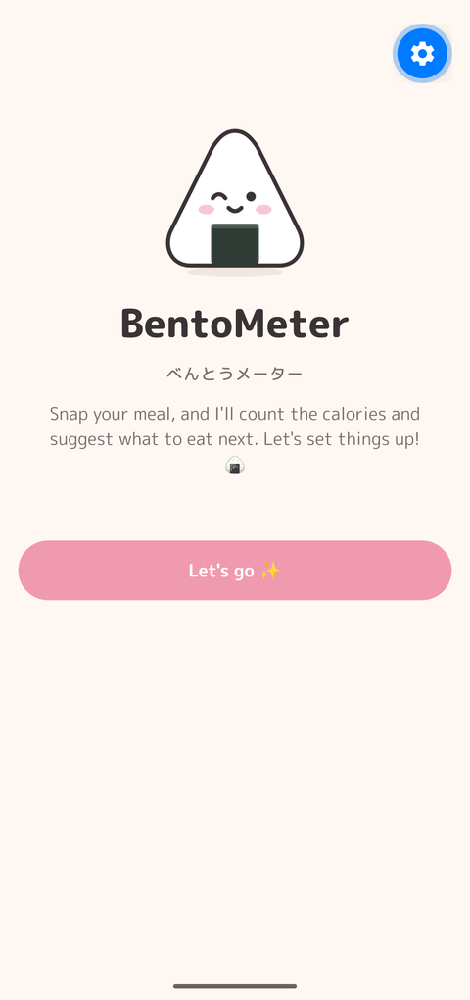<br/><sub><b>Welcome</b> ようこそ</sub></td>
    <td align="center">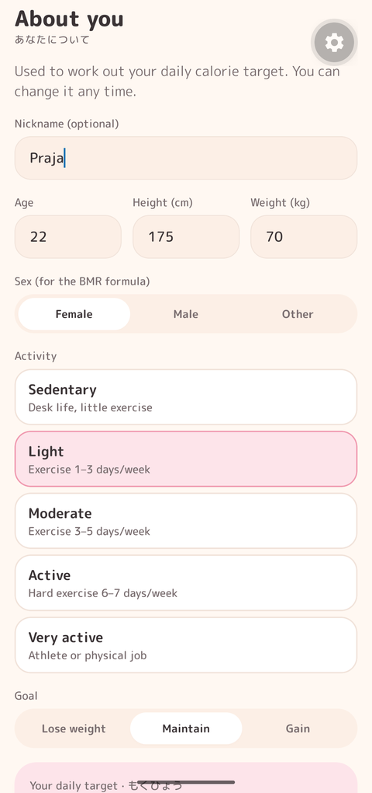<br/><sub><b>About you</b> あなたについて</sub></td>
    <td align="center">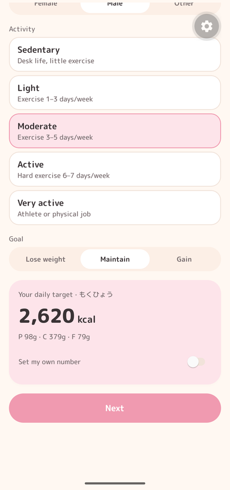<br/><sub><b>Goal &amp; target</b> もくひょう</sub></td>
    <td align="center">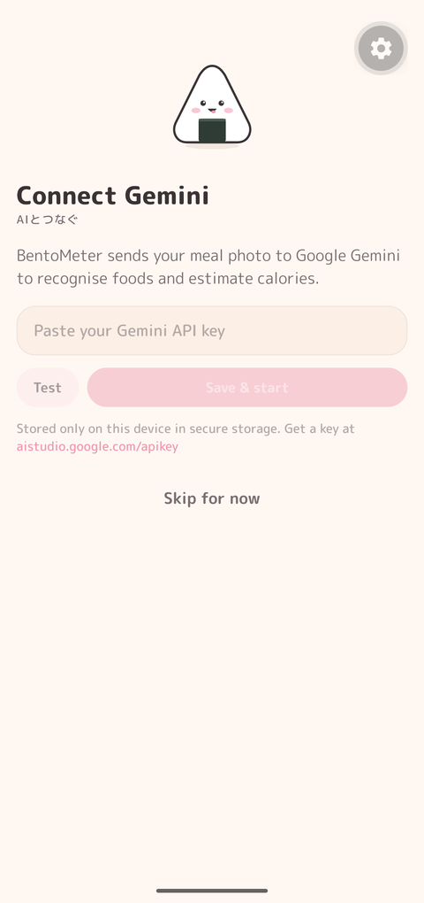<br/><sub><b>Connect Gemini</b> AIとつなぐ</sub></td>
  </tr>
</table>

### ② Log a meal: snap, analyze, review ｜ ごはんをきろく

The meal slot is picked from the clock (🍳 breakfast, 🍱 lunch, 🍡 snack, 🍜 dinner, 🌙 late snack). Snap a photo or pick one from your gallery. You can add a note for Gemini like *"ate half the rice"*, then tap **Analyze**. Your onigiri thinks hard while it waits `(・・ )?`

<table>
  <tr>
    <td align="center">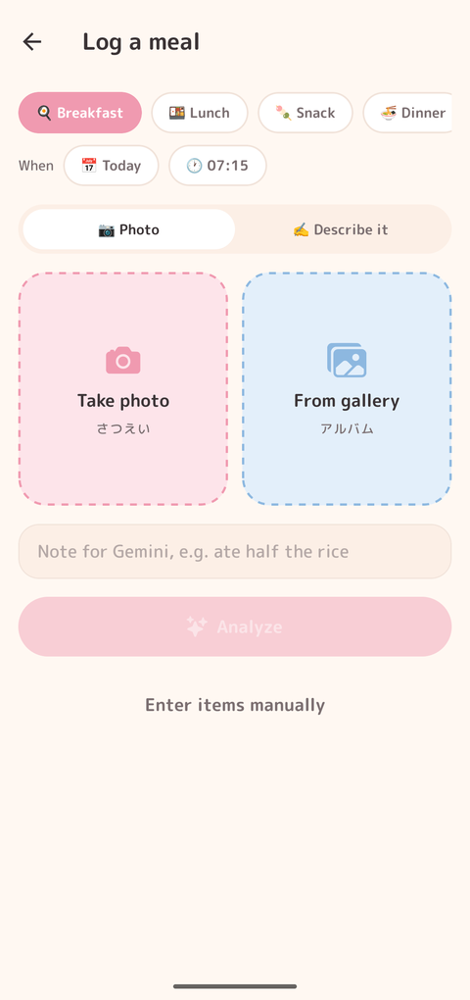<br/><sub><b>Log a meal</b> さつえい</sub></td>
    <td align="center">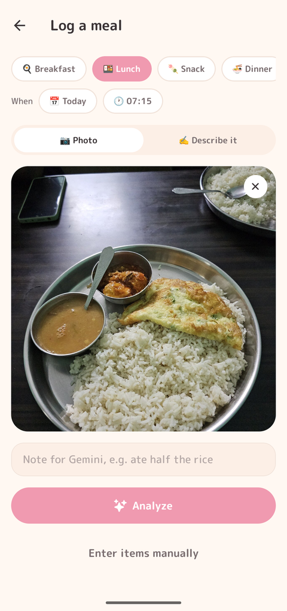<br/><sub><b>Photo picked</b> アルバム</sub></td>
    <td align="center">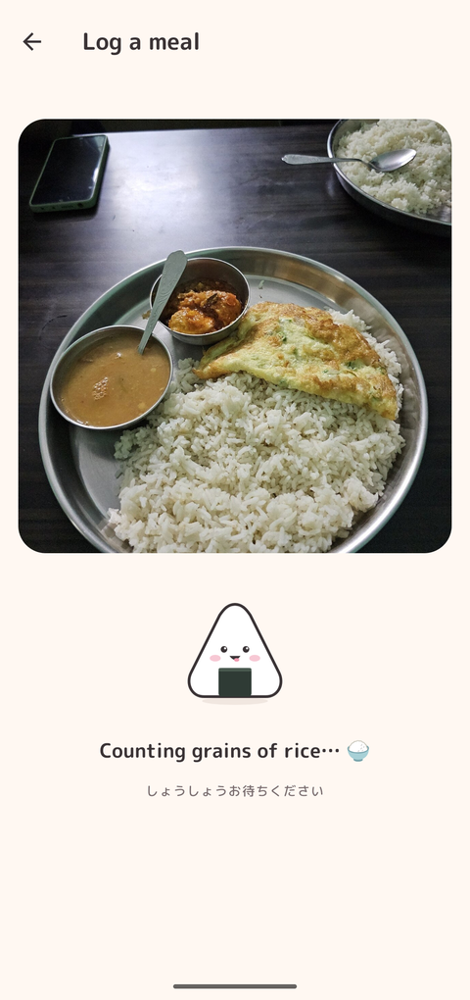<br/><sub><b>Analyzing…</b> しょうしょうお待ちください</sub></td>
  </tr>
</table>

### ③ Review &amp; save: everything is editable ｜ かくにん

Gemini returns every item with portion, kcal, and macros. Tap **+ / −** to change quantities and the numbers rescale instantly on-device. You can also rename items, change units, fix kcal, and add or remove items. Below that is your **Next up** suggestion, with 2–3 ideas and a tiny pep talk. ٩(◕‿◕｡)۶

<table>
  <tr>
    <td align="center">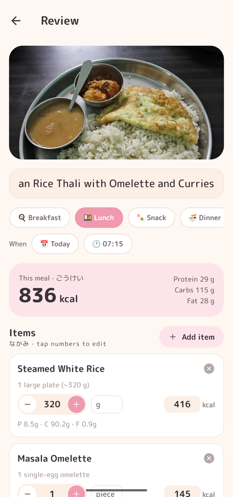<br/><sub><b>Review items</b> なかみ</sub></td>
    <td align="center">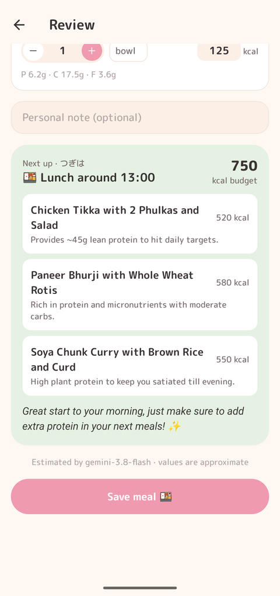<br/><sub><b>Next up</b> つぎは</sub></td>
  </tr>
</table>

### ④ Your day, as a bento box ｜ きょうのごはん

The calorie ring shows how much is left today (のこり), with soft macro bars for protein, carbs, and fat. Each meal fills its own bento compartment with its photo. Tap a meal to see the full breakdown, edit it, or delete it.

<table>
  <tr>
    <td align="center">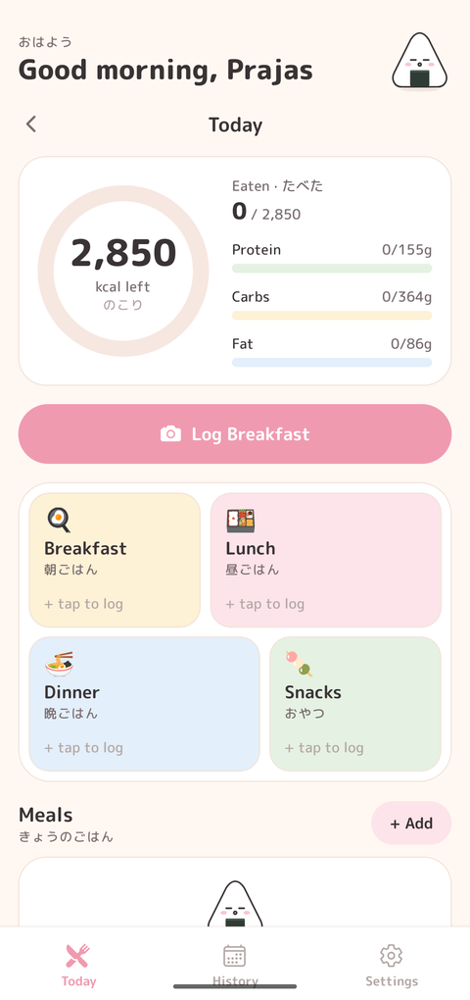<br/><sub><b>Empty day</b> まだなにも…</sub></td>
    <td align="center">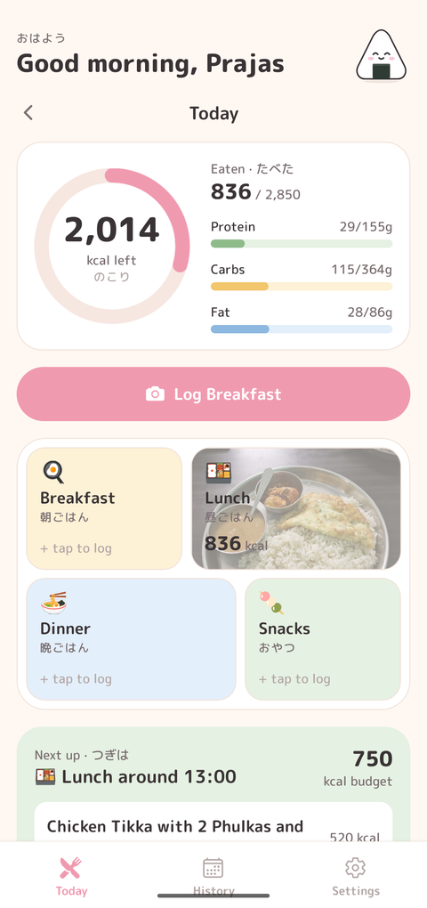<br/><sub><b>After lunch</b> いただきました</sub></td>
    <td align="center">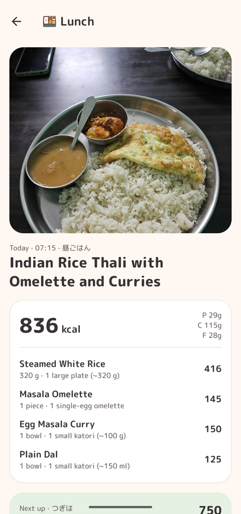<br/><sub><b>Meal detail</b> ごはんのなかみ</sub></td>
  </tr>
</table>

### ⑤ History &amp; settings ｜ きろく・せってい

Look back at the last 7 days and the month calendar, where each day gets a dot: 🟡 under, 🟢 on target, 🔴 over. In Settings you can switch themes, change your profile, pick a Gemini model, and back up your data.

<table>
  <tr>
    <td align="center">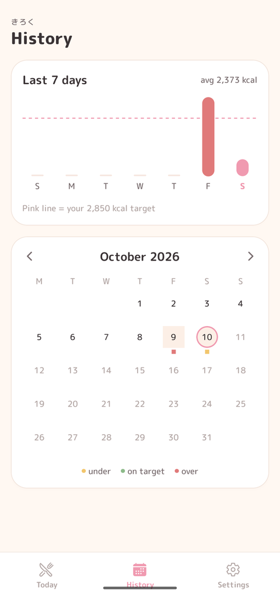<br/><sub><b>History</b> きろく</sub></td>
    <td align="center">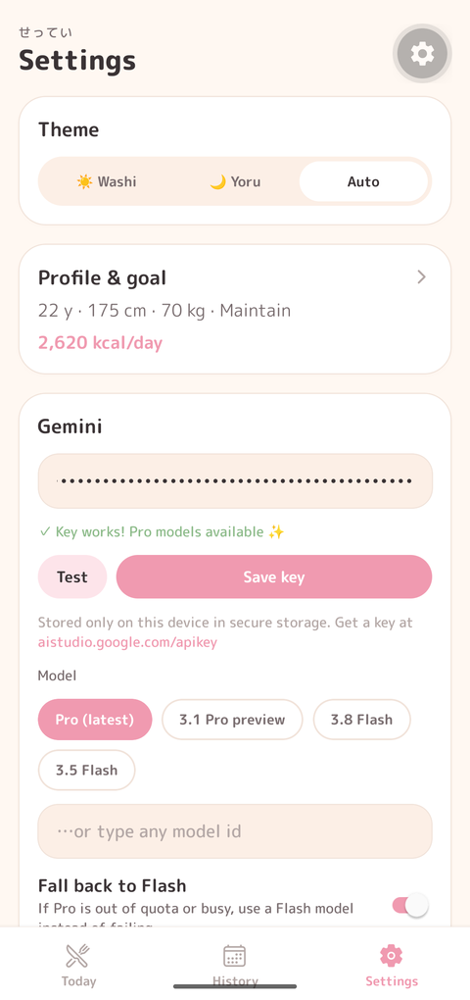<br/><sub><b>Settings</b> せってい</sub></td>
  </tr>
</table>

---

## ✨ What it can do ｜ できること

| | Feature | |
|---|---|---|
| 📸 | **Photo logging:** take a photo or pick from the gallery. Gemini identifies each food with portion, kcal, protein, carbs, and fat | しゃしん |
| ✍️ | **"Describe it" mode:** no photo? Just type *"a cup of masala chai and 4 Parle-G biscuits"* | ことばで |
| 📝 | **Manual entry:** add items yourself, no AI needed | てにゅうりょく |
| 💬 | **Notes for Gemini:** e.g. *"ate half the rice"* or *"no oil"*, for better estimates | メモ |
| ⏰ | **Smart meal slot:** picked from the time of day. Falls back to *snack* if that meal is already logged | じかん |
| 🎚️ | **Editable review:** quantity steppers rescale kcal and macros locally (values are stored per unit). Edit names, units, and kcal; add or remove items | へんしゅう |
| 🍙 | **"Next up" suggestion:** next meal, time, kcal budget, 2–3 ideas, and a friendly tip, all from the same request. A refresh button appears if you change the meal by more than 15% | つぎは |
| 🗓️ | **Log any day:** add earlier meals, log other days, and edit or delete past meals | いつでも |
| 🍱 | **Bento-box day view:** calorie ring, macro bars, and photo compartments | おべんとう |
| 📊 | **History:** 7-day chart and a month calendar with under / on target / over dots. Tap a day to jump to it | きろく |
| 🧮 | **Personal targets:** BMR/TDEE with Mifflin-St Jeor plus your activity level and goal (lose / maintain / gain), or set your own number | もくひょう |
| 🤖 | **Gemini model picker + fallback:** see [below](#-gemini-models--モデル) | モデル |
| 🌗 | **Themes:** ☀️ Washi, 🌙 Yoru, or Auto (follows the system) | テーマ |
| 💾 | **Backup:** JSON export and import (photos not included) | バックアップ |
| 🔒 | **Private by design:** SQLite on-device, API key in the secure store (`expo-secure-store`), never in the source | ひみつ |

---

## 🛠️ Setup &amp; run ｜ じゅんび

### What you need `(•̀ᴗ•́)و`

- 🟢 **Node.js 20+** and npm
- 📱 **A phone with [Expo Go](https://expo.dev/go)**, *or* an Android emulator / iOS simulator
- 🔑 **A Gemini API key**: free at **[aistudio.google.com/apikey](https://aistudio.google.com/apikey)**

### 1. Clone &amp; install

```bash
git clone https://github.com/PrajasW/BentoMeter.git
cd BentoMeter
npm install
```

### 2. Start the dev server

```bash
npx expo start
```

Then:

- 📱 **Phone:** scan the QR code with Expo Go (Android) or the Camera app (iOS). Your phone and computer need to be on the same Wi-Fi.
- 🤖 **Android emulator:** press `a`
- 🍎 **iOS simulator (macOS):** press `i`

> 💡 If the phone can't reach your computer (campus or office Wi-Fi), try `npx expo start --tunnel`.

### 3. First launch

1. Fill in **About you** (age, height, weight, activity, goal). Your daily target is calculated for you.
2. Paste your **Gemini API key** and tap **Test** to check it works.
3. Log your first meal! 🍙✨

Your key is stored only on the device (secure store). It's never committed or sent anywhere except Google's Gemini API.

### 4. (Optional) Build a real app 📦

BentoMeter uses Continuous Native Generation, so the `android/` and `ios/` folders are generated and you never edit them by hand.

```bash
# Local build on a connected Android device / emulator (needs Android Studio + JDK 17+)
npx expo run:android --variant release

# Or build in the cloud with EAS (no local Android Studio / Xcode needed)
npx eas-cli@latest build:configure     # first time only, creates eas.json
npx eas-cli@latest build --platform android
```

---

## 🤖 Gemini models ｜ モデル

The default is **`gemini-pro-latest`**. If Pro has no quota (free-tier keys get 0 Pro requests) or is overloaded, BentoMeter falls back automatically:

```
gemini-pro-latest → gemini-3.1-pro-preview → gemini-3.8-flash → gemini-3.5-flash → gemini-flash-latest
```

It remembers models that failed for a while, so later calls go straight to one that works. In **Settings** you can pick a model, type any model id, or turn the fallback off. `(ง •̀_•́)ง`

---

## 🗺️ Code map ｜ ちず

| Path | What's inside |
| --- | --- |
| `src/app/` | Screens (Expo Router): `(tabs)/index` Today, `(tabs)/history`, `(tabs)/settings`, `capture`, `review`, `meal/[id]`, `onboarding`, `profile` |
| `src/components/` | `Mascot` 🍙, `CalorieRing`, `BentoGrid`, `MacroBars`, `FoodItemRow`, `RecommendationCard`, `KawaiiLoader`, … |
| `src/lib/gemini.ts` | Prompt, JSON schema, model fallback chain, response parsing |
| `src/lib/db.ts` | SQLite schema + queries (profile, settings, meals, food_items) |
| `src/lib/mealSlot.ts`, `nutrition.ts` | Time → meal slot, BMR/TDEE/targets, per-unit scaling |
| `src/lib/backup.ts` | JSON export / import |
| `src/theme/` | Washi ☀️ / Yoru 🌙 tokens + `ThemeProvider` |
| `src/store/` | Zustand app store |

---

## 🧪 Checks ｜ テスト

```bash
npm test            # unit tests: slot logic, nutrition math, Gemini response parsing
npx tsc --noEmit    # typecheck
npx expo-doctor     # dependency / config health check
```

---

<div align="center">

Made with 🍙 and a little bit of 🌸

`ごちそうさまでした！ (*´▽｀*)♡`

<sub>Calorie values are AI estimates. Please don't use them for medical decisions. 🩺</sub>

</div>
